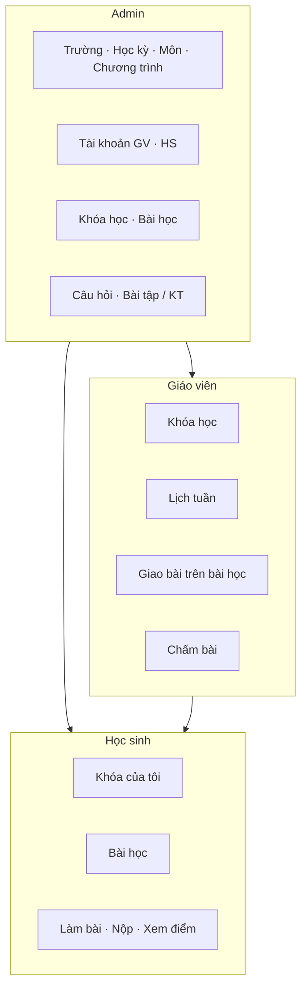

# Hướng dẫn luồng sử dụng — CleverSchool LMS

Tài liệu mô tả quy trình thực tế trên giao diện web: **Admin** thiết lập → **Giáo viên** giao bài → **Học sinh** làm bài.

Cập nhật: **2026-06-18**  
Liên quan: [ui-design.md](./ui-design.md), [be/docs/features.md](../../be/docs/features.md), [be/docs/requirement.md](../../be/docs/requirement.md)

---

## 1. Vai trò và điểm vào hệ thống

| Vai trò | Sau đăng nhập | Menu / URL chính |
|---------|---------------|------------------|
| **Admin** | Dashboard quản trị | `/admin/dashboard` — Người dùng, Trường, Môn học, Chương trình, Khóa học, Học liệu, Học kỳ |
| **Giáo viên** | Khóa học được giao | `/teacher/courses`, `/teacher/lessons` |
| **Học sinh** | Khóa đã tham gia | `/courses` |



**Nguyên tắc quan trọng**

- Học sinh / giáo viên **chỉ thấy khóa học** đã được gắn vào tài khoản.
- **Tạo bài** (homework, exercise, exam) khác với **giao bài**: học sinh chỉ làm được bài có `is_assigned = true` trên bài học.
- Admin có thể làm hầu hết thao tác qua `/manage/*` và `/admin/*`; giáo viên dùng `/teacher/*`.

---

## 2. Admin — Thiết lập từ đầu (thứ tự khuyến nghị)

### 2.1 Đăng nhập

1. Mở trang đăng nhập, nhập tài khoản admin.
2. Sau login, API dùng header `Token: <jwt>`.

Lần đầu trên môi trường mới: xem [be/docs/getting-started.md](../../be/docs/getting-started.md) (migrate, seed admin).

### 2.2 Trường học & lớp

| Bước | Đường dẫn | Việc cần làm |
|------|-----------|--------------|
| Danh sách trường | `/admin/schools` | Tạo / sửa trường |
| Chi tiết trường | `/admin/schools/detail/[id]` | Thêm lớp, học sinh, giáo viên tại trường |

**Lưu ý:** Khi tạo lớp, chọn **khối** (grades 1–12). Không gửi `grade_id = 0` (lỗi FK).

### 2.3 Học kỳ & khung thời gian

| Bước | Đường dẫn | Việc cần làm |
|------|-----------|--------------|
| Học kỳ | `/admin/semesters` | Tạo học kỳ: tên, mô tả, **ngày bắt đầu / kết thúc**, tuần đầu / tuần cuối |

Học kỳ dùng khi tạo khóa học và xếp **lịch bài học theo tuần**.

### 2.4 Môn học & chương trình

| Bước | Đường dẫn | Việc cần làm |
|------|-----------|--------------|
| Môn học | `/admin/subjects` | Tạo môn (VD: Tiếng Anh) |
| Chương trình | `/manage/programs` | Khung chương trình + thời lượng |
| Chi tiết CT | `/manage/programs/[id]` | Thêm **chương** và **bài học** mẫu |
| Sửa CT | `/manage/programs/[id]/edit` | Ảnh bìa: **chỉ upload file** (không nhập link URL). **Thêm chương / thêm bài học** tại đây (nút trong tab *Chương & Bài học*) |

> **Quan trọng:** Bài học gắn vào **chương trình**, không gắn trực tiếp vào khóa học. Màn **Sửa khóa học** (`/manage/courses/[id]/edit`) chỉ **xem** chương/bài + **Schedule** (lịch tuần), **không** có nút thêm bài học.

### 2.5 Tạo giáo viên & học sinh

**Cách 1 — Danh sách người dùng (khuyến nghị)**

| Bước | Đường dẫn |
|------|-----------|
| Danh sách | `/admin/users/list` — tab HS, GV, Admin, **Quản lý trường** |
| Tạo GV | `/admin/users/list/create?role=2` |
| Tạo HS | `/admin/users/list/create?role=3` |

**Cách 2 — Từ trang trường**

- Vào chi tiết trường → tab Học sinh / Giáo viên → Thêm (modal).

**Trường cần điền**

| Vai trò | Bắt buộc / nên có |
|---------|-------------------|
| Học sinh | Họ tên, username, mật khẩu, **trường**, **lớp**; có thể gắn **khóa học** |
| Giáo viên | Họ tên, username, mật khẩu, **trường** (có thể nhiều), **lớp**, **môn**, **khóa học** |

### 2.6 Tạo khóa học

| Bước | Đường dẫn |
|------|-----------|
| Danh sách | `/manage/courses` |
| Tạo mới | `/manage/courses/create` |

**Form tạo khóa** (dùng chung admin / giáo viên):

- Tên, mô tả, ảnh cover
- **Chương trình** (kéo theo chương + bài học)
- **Trường**, **học kỳ** (có thể chọn nhiều học kỳ)
- **Ngày bắt đầu / kết thúc** khóa
- Gắn **học sinh**, **giáo viên** (hoặc gắn sau ở màn sửa)

| Sửa khóa | `/manage/courses/[id]/edit` hoặc `/teacher/courses/[id]/edit` | Tab *Chương & Bài học*: chỉ xem + Schedule. **Sửa chương** → `/manage/programs/[programId]/edit` (nút link trên tab) |

### 2.7 Ngân hàng câu hỏi & tạo bài

| Hạng mục | Đường dẫn |
|----------|-----------|
| Ngân hàng câu hỏi | `/manage/question-bank` |
| Tạo câu hỏi (admin) | `/admin/question-bank/create-question` |
| Tạo câu hỏi (GV) | `/teacher/question-bank/create-question` |
| Quản lý bài (admin) | `/admin/assignments` |
| Quản lý bài (manage) | `/manage/assignments` |

**Ba loại bài**

| Loại | Tên tiếng Anh | Mục đích | Tạo mới (ví dụ) |
|------|---------------|----------|-----------------|
| Bài tập về nhà | Homework | Bài về nhà gắn bài học | `/manage/assignments/create-homework` |
| Bài luyện tập | Exercise | Luyện trong bài học | `/manage/assignments/create-exercise` |
| Bài kiểm tra | Exam | Kiểm tra có thời gian / hạn nộp | `/manage/assignments/create` |

**Cài thời gian — Bài kiểm tra (Exam)**

- **Thời gian làm bài** (`time_limit`, phút)
- **Hạn nộp** (`deadline`: chọn ngày + giờ)

Homework / Exercise: cấu hình trong form tạo/sửa tương ứng; bài gắn với **bài học** cụ thể.

**Chín dạng câu hỏi (ngân hàng câu hỏi)** — dùng trong homework / exercise / exam:

| # | Loại API | Tên hiển thị |
|---|----------|--------------|
| 1 | `multiple_choice` | Trắc nghiệm |
| 2 | `fill_in_blanks` | Điền khuyết |
| 3 | `ordering` | Sắp xếp |
| 4 | `matching` | Ghép cặp |
| 5 | `drag_drop` | Kéo thả |
| 6 | `labeling` | Gắn nhãn |
| 7 | `category` | Phân loại |
| 8 | `writing` | Viết (chấm tay) |
| 9 | `speaking` | Nói (chấm tay / ghi âm) |

Tạo/sửa: admin + GV question-bank; làm bài: `/manage/assignments/do-homework|do-exercise|do/[examId]`.

### 2.8 Gắn bài vào bài học

| Đường dẫn | Việc cần làm |
|-----------|--------------|
| Sửa bài học | `/manage/lessons/[id]/edit` | Chọn exam, homework, exercise, bài giảng, từ vựng → **Lưu** (nút lưu chính của form) |
| Xem bài học | `/manage/lessons/[id]` hoặc `/manage/programs/[id]/lessons/[lessonId]` | Kiểm tra tab nội dung sau khi lưu. **GV** (kèm `?course_id=`) thấy đủ tab Bài tập / Luyện tập / Kiểm tra, nút **Giao bài** và **Chấm điểm**. **Admin** không có **Chấm điểm** (route `/teacher/...`). |
| Từ chương trình | `/manage/programs/[id]/edit` | Tab *Chương & Bài học* → **Thêm chương** / **Thêm bài học** |

**Luồng lưu (2026-06-18)**

1. Exam / homework / exercise / **bài đánh giá (assessment)** / bài giảng: gửi qua `PUT /api/manage/lessons/:id` (mức **chương trình**, không phụ thuộc `?course_id=` trên URL). Field API: `assessments` (mảng `{ id, name }`).
2. Từ vựng: sau khi lưu bài học, FE gọi `PUT /api/manage/flashcard/lessons/:id/vocabularies` với danh sách `vocabulary_ids` (mảng rỗng = xóa hết từ vựng khỏi bài).

> Tạo xong bài **chưa đủ** — cần **giao bài** (mục 4) thì học sinh mới thấy.

---

## 3. Cài lịch & thời gian

### 3.1 Học kỳ (Admin)

1. `/admin/semesters` → tạo học kỳ, khoảng ngày, tuần bắt đầu / kết thúc.
2. Tuần học (`weeks`) là đơn vị xếp lịch trên khóa.

### 3.2 Lịch khóa — gán bài học theo tuần (GV / Admin)

1. Mở **Sửa khóa học:** `/teacher/courses/[id]/edit`
2. Chọn **Lịch học** (ScheduleModal):
   - Chọn tuần trong học kỳ
   - Gán từng **bài học** vào tuần
   - **Lưu** khi đã gán hết (hệ thống cảnh báo nếu còn bài chưa gán)

**Đồng bộ lịch khóa clone (nâng cao):** nút đồng bộ lịch cùng nhóm chương trình — chỉ copy **lịch học**, không copy học sinh/tên khóa. Xem [be/docs/features.md](../../be/docs/features.md) §3.1.

### 3.3 Thời gian khóa học

- **Ngày bắt đầu / kết thúc** khi tạo hoặc sửa khóa
- **Học kỳ** đã chọn trên khóa
- Học sinh học theo bài đã giao trong khóa đang hoạt động

---

## 4. Giáo viên — Giao bài tập

### 4.1 Luồng chính

```
Đăng nhập → Khóa học → Chọn khóa → Bài học → Tab bài tập → Bật "Giao bài"
```

| Bước | Đường dẫn | Hành động |
|------|-----------|-----------|
| 1 | `/teacher/courses` | Chọn khóa được phân công |
| 2 | `/teacher/lessons/[id]?course_id=...` | Mở bài học (luôn kèm `course_id` trên URL khi giao bài) |
| 3 | Tab **Bài tập / Luyện tập / Kiểm tra / Đánh giá** | Danh sách bài đã gắn bài học |
| 4 | Nút **Giao** / **Thu hồi** | `is_assigned = true` → HS thấy bài |

**API giao bài tập về nhà:** `POST /api/manage/homeworks/{id}/assigned`  
Body: `{ lesson_id, is_assigned, course_id? }`  
(Exercise / Exam / **Assessment** tương tự: `POST /manage/exercises|exams|assessments/{id}/assigned`.)

### 4.2 Tạo bài mới (giáo viên)

1. `/manage/assignments` → tạo homework / exercise / exam
2. Gắn bài vào bài học (nếu chưa gắn khi tạo)
3. Vào bài học → **Giao bài**

### 4.3 Giao từ giáo án (lecture bank)

- Xem giáo án / preview bài giảng → **Giao bài tập** trực tiếp (`AssignHomework` kèm `course_id`).

### 4.4 Chấm bài

| Tình huống | Đường dẫn |
|------------|-----------|
| Danh sách HS — bài kiểm tra | `/teacher/lessons/[id]/exam/[examId]?course_id=...` (bắt buộc `course_id` trên URL) |
| Chấm / xem bài kiểm tra từng HS | `/teacher/lessons/[id]/exam/[examId]/student/[studentId]?course_id=...` |
| Danh sách HS — luyện tập | `/teacher/lessons/[id]/exercise/[exerciseId]?course_id=...` — cột **Reset lượt làm** (HS đã nộp) |
| Chấm bài tập HS (tự luận / upload) | `/teacher/lessons/[id]/homework/[homeworkId]/student/[studentId]` |
| Báo cáo / theo dõi | `/teacher/reports` — tab **Bài tập về nhà** (BTVN), **Bài luyện tập** (exercise), **Bài kiểm tra** (exam). Tab *Kiểm tra và đánh giá* / *Xuất mẫu* ẩn — `fe/config/hiddenModules.ts` |

Trắc nghiệm: hệ thống **chấm tự động** sau khi HS nộp. GV vẫn mở trang chấm để **xem điểm** và chấm tay câu Writing/Speaking (nếu có).

---

## 5. Học sinh — Làm bài tập

### 5.1 Luồng chính

```
Đăng nhập → Khóa học của tôi → Chọn khóa → Bài học → Chọn bài → Làm → Nộp → Xem kết quả
```

| Bước | Đường dẫn | Ghi chú |
|------|-----------|---------|
| 1 | `/courses` | Chỉ khóa đã tham gia |
| — | Menu: `/assignments`, `/progress-report`, `/ranking`, `/feedback` | Xếp hạng & phản hồi hiển thị trên header HS |
| 2 | `/courses/[id]` | Chương / danh sách bài học |
| 3 | `/courses/[id]/lesson/[lessonId]` | Tab homework, exercise, exam |
| 4 | Làm bài | Xem bảng dưới |
| 5 | Kết quả | URL `.../result` tương ứng |

**URL làm bài (sau khi bấm từ bài học)**

| Loại | Route làm bài | Route xem kết quả |
|------|---------------|-------------------|
| Homework | `/manage/assignments/do-homework/[id]` | `.../do-homework/[id]/result` |
| Exercise | `/manage/assignments/do-exercise/[id]` | `.../do-exercise/[id]/result` |
| Exam | `/manage/assignments/do/[id]` | `.../do/[id]/result` |

URL thường có thêm `lesson_id`, `course_id` (query) — không xóa khi chia sẻ / bookmark.

### 5.2 Xử lý sự cố thường gặp

| Triệu chứng | Nguyên nhân | Cách xử lý |
|-------------|-------------|------------|
| Khóa học không có bài học | Chương trình chưa có chương/bài | Sửa CT tại `/manage/programs/[id]/edit` |
| Tab *Chương & Bài học* trên sửa khóa trống | Khóa chưa gắn CT hoặc CT chưa có nội dung | Chọn chương trình khi sửa khóa; thêm bài ở sửa CT |
| Không gửi `course_id` khi PUT lesson | Phiên bản cũ gửi `course_id` khi PUT | Cập nhật BE+FE 2026-06-18; restart BE |
| PUT lesson 500 `*_course_id_fkey` | `course_id = 0` không hợp lệ với FK | BE dùng NULL (`Omit CourseId`); cập nhật 2026-06-18 |
| PUT lesson 500 | Lỗi `dependency_id` / duplicate lesson_plan | Cập nhật BE 2026-06-18 |
| Từ vựng không lưu | Chưa sync flashcard API | Cập nhật FE 2026-06-18; bấm **Lưu** form bài học |
| `/courses` trống | Chưa gắn khóa | Admin sửa user → thêm khóa học |
| Vào bài học không thấy bài tập | Chưa **giao bài** | GV bật **Giao bài** trên `/teacher/lessons/[id]?course_id=...` cho từng homework/exercise/exam |
| HS không thấy tab Luyện tập / Kiểm tra | Tab bị ẩn trên UI (đã sửa) | Vào bài học từ **Khóa học** → `/courses/[courseId]/lesson/[lessonId]` — có 3 tab: Bài tập về nhà, Luyện tập, Bài kiểm tra |
| Không nộp được kiểm tra | Quá deadline / hết time_limit | Kiểm tra cấu hình exam |
| 401 / không vào được | Sai token / hết phiên | Đăng nhập lại |
| Báo cáo tiến độ — tab Bài luyện tập trống | API cũ (homework) hoặc BE chưa có route mới | Cập nhật BE+FE 2026-06-21; **restart backend**; chọn đúng khóa học |
| Luyện tập nộp xong vẫn **Làm bài** / không lưu kết quả | Thiếu `lesson_id` khi gọi `save-score/bulk` | Cập nhật BE+FE 2026-06-21; vào bài từ tab Luyện tập bài học (URL có `lessonId`); restart BE |
| Báo cáo tiến độ — 404 `exercise-list` | Server Go chạy bản cũ | Dừng process port 8080 → `go run .` trong `be/` |
| Tab **Điểm** trên `/courses/[id]` trống dù đã làm bài KT | FE đọc sai field API (`exam_ressults`) | Cập nhật FE 2026-06-22; reload trang; cần bài kiểm tra đã **giao** trong khóa |
| Tab **Đánh giá** báo cáo tiến độ — dropdown trống / 403 | HS gọi `/manage/assessments` | Cập nhật BE+FE 2026-06-22: `GET /dashboard/student/assessment-list`; restart BE |
| Tab **Bài tập về nhà** báo cáo tiến độ trống dù HS đã làm BTVN | FE gọi nhầm API exercise | Cập nhật FE 2026-06-22: dùng `homework` + `homework-list`; reload trang |
| Trang **`/assignments` HS trống** | `weeks` = 0 → FE không gọi API; BE chỉ join `lesson_schedules` | Cập nhật 2026-06-22: FE gọi API khi không có tuần (`week_id=0`); BE fallback `*_ref_lessons`; restart BE |

### 5.3 Báo cáo tiến độ (`/progress-report`)

Menu học sinh → **Báo cáo tiến độ**.

| Tab | Nội dung | API |
|-----|----------|-----|
| Bài tập về nhà | Thống kê + bảng chi tiết **homework** (BTVN) đã giao / đã làm | `GET /dashboard/student/homework`, `homework-list` |
| Đánh giá | Bài assessment theo môn / khóa | `GET /dashboard/student/assessment-list` (dropdown), `GET /dashboard/student/assessments` (bảng điểm) |

**Tab Bài tập về nhà — hiển thị:** tỉ lệ làm đúng, số bài đã làm / được giao, tỷ lệ hoàn thành, câu đã hoàn thành, biểu đồ theo tuần, bảng chi tiết (làm tiếp / xem kết quả).

**Đã ẩn (2026-06-21):** bộ lọc loại bài exam/homework, thống kê Gem, cột số câu bỏ qua, dữ liệu mock biểu đồ.

**Lưu ý:** Chỉ đếm BTVN **đã giao** (`homework_ref_lessons.assigned_by > 0`) trong khóa đã chọn. **Bài luyện tập** (exercise trong bài học) không nằm tab này — xem trong bài học hoặc báo cáo GV.

**Tab Đánh giá:** bài assessment gắn bài học (`assessment_ref_lessons`). HS: xem điểm (sau publish), nộp file bài làm (`POST /study/assessment-submit`), xem nhận xét (`GET /manage/study-reports`). GV: `/teacher/reports` tab *Kiểm tra và đánh giá* — chấm điểm + nhận xét. Admin: `/manage/assignments` tab *Đánh giá*.

---

## 6. Phân biệt ba loại bài

| | Homework | Exercise | Exam |
|---|----------|----------|------|
| **Mục đích** | Bài về nhà | Luyện tập | Kiểm tra |
| **Thời gian** | Theo cấu hình bài / deadline | Linh hoạt | `time_limit` + `deadline` |
| **Ai tạo** | Admin / GV | Admin / GV | Admin / GV |
| **Ai giao** | GV trên bài học | GV trên bài học | GV trên bài học |
| **HS làm** | `do-homework` | `do-exercise` | `do` |

---

## 7. Checklist theo vai trò

### Admin — Triển khai trường mới

- [ ] Trường, lớp (chọn đúng khối)
- [ ] Học kỳ + tuần
- [ ] Môn học, chương trình, bài học mẫu
- [ ] Tài khoản GV, HS + gắn trường / lớp
- [ ] Khóa học + chương trình + học kỳ + HS / GV
- [ ] Câu hỏi + bài (homework / exercise / exam)
- [ ] Gắn bài vào bài học
- [ ] GV: xếp lịch tuần + **giao bài**
- [ ] HS: đăng nhập thử làm 1 bài

### Giáo viên — Mỗi tuần

- [ ] Kiểm tra lịch tuần trên khóa
- [ ] Giao bài cho bài học tuần đó
- [ ] Theo dõi HS chưa nộp
- [ ] Chấm bài cần chấm tay

### Học sinh

- [ ] `/courses` → chọn khóa
- [ ] Vào bài học đúng tuần
- [ ] Làm và nộp bài
- [ ] Xem điểm / kết quả

---

## 8. Dashboard admin (MVP)

Cấu hình: `fe/config/adminDashboard.ts`

| Hiển thị | Ẩn |
|----------|-----|
| Tab Tổng quan + Cảnh báo | 5 tab còn lại |
| Trường, GV, HS, hoạt động hôm nay, biểu đồ khóa | Thẻ online chi tiết, tỉ lệ hoàn thành, … |
| HS không hoạt động, GV chấm chậm | Thống kê Speaking/Writing |

Luồng học tập (mục 2–5) **không thay đổi** — chỉ màn báo cáo gọn hơn.

---

## 9. Triển khai VPS / đồng bộ môi trường

Sau khi cập nhật code hoặc migration trên server:

1. Push backend → CI deploy → migration tự chạy (hiện tại tới `0051` — quyền feedback/H5P/role trường)
2. Trên VPS: `go run . refresh-permissions` (hoặc lệnh tương đương trong container) nếu gặp 403 sau bật menu mới
3. Chạy `post-deploy-check.sh` trên VPS (nếu có)
4. Push frontend → Vercel redeploy
5. Kiểm tra `NEXT_PUBLIC_API_BASE_URL` khớp API

Chi tiết: [be/docs/vps-release-checklist.md](../../be/docs/vps-release-checklist.md)

---

## 10. Tài liệu liên quan

| File | Nội dung |
|------|----------|
| [be/docs/getting-started.md](../../be/docs/getting-started.md) | Cài đặt local, migrate, seed admin |
| [be/docs/features.md](../../be/docs/features.md) | API, module, migration |
| [be/docs/vps-release-checklist.md](../../be/docs/vps-release-checklist.md) | Deploy VPS + Vercel |
| [fe/docs/ui-design.md](./ui-design.md) | UI admin, dashboard MVP |
| [fe/AGENTS.md](../AGENTS.md) | Quy tắc sửa FE |
